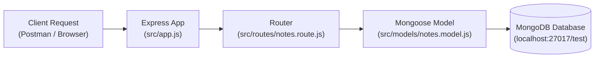

# Day 07: Mongoose Models & Schemas

## 🎯 Learning Objectives

By the end of this module, you will understand:
1. What an **ODM (Object Data Modeling)** library is and why we use **Mongoose** with MongoDB.
2. The core difference between a **Mongoose Schema** and a **Mongoose Model**.
3. How to structure a production-ready folder architecture separating config, models, and routes.
4. How to perform asynchronous database operations (`create`, `find`) using `async/await`.
5. How to send proper HTTP status codes (`201 Created`, `200 OK`) along with structured JSON responses.
6. How to extend schemas with validations, timestamps, and error handling.

---

## 🧭 Step-by-Step Learning Path



---

### Step 1: Understanding Schema vs Model

| Concept | What It Is | Analogy | Mongoose Syntax |
|---|---|---|---|
| **Schema** | The blueprint/definition of document structure, data types, and validation rules. | An architectural blueprint for a house. | `new mongoose.Schema({ ... })` |
| **Model** | A compiled constructor wrapper around the Schema providing query methods (`create`, `find`, etc.). | The actual construction crew that builds and inspects houses. | `mongoose.model('notes', noteSchema)` |
| **Document** | A single instance/record created from a Model that maps to a MongoDB BSON document. | A specific house built using that blueprint. | `{ title: "Learn Express", description: "..." }` |

> [!NOTE]
> When you name a model `mongoose.model("notes", noteSchema)`, Mongoose automatically looks for the lowercase, pluralized collection name in MongoDB.

---

### Step 2: Project Architecture Breakdown

In Day 07, we separate concerns across distinct modules:

```text
Day07 - Models/
├── package.json
├── server.js               # Application entry point & port listener
└── src/
    ├── app.js              # Express app bootstrap & route mounting
    ├── config/
    │   └── database.js     # Mongoose connection logic
    ├── models/
    │   └── notes.model.js  # Note Schema & Model definition
    └── routes/
        └── notes.route.js  # Note endpoints (POST /notes, GET /notes)
```

#### Why Decouple `server.js` and `app.js`?
- **`app.js`** focuses solely on configuring Express middleware, parser utilities, and mounting route handlers.
- **`server.js`** handles infrastructure concerns: connecting to MongoDB via `connectDB()` and binding to the network port via `app.listen()`.
- This separation facilitates unit/integration testing without booting up network listeners.

---

### Step 3: Code Walkthrough

#### 1. Database Connection (`src/config/database.js`)
```javascript
const mongoose = require('mongoose');

function connectDB() {
    mongoose.connect('mongodb://localhost:27017/test')
        .then(() => {
            console.log('MongoDB connected successfully');
        })
        .catch((err) => {
            console.error('MongoDB connection error:', err);
        });
}

module.exports = connectDB;
```

#### 2. Defining Schema & Model (`src/models/notes.model.js`)
```javascript
const mongoose = require('mongoose');

const noteSchema = new mongoose.Schema({
    title: String,
    description: String
});

const noteModel = mongoose.model("notes", noteSchema);

module.exports = noteModel;
```

#### 3. Handling Asynchronous Routes (`src/routes/notes.route.js`)
Database queries are asynchronous I/O operations and return Promises. Always use `async/await`:

- **Creating a Note (`POST /notes`)**:
  ```javascript
  noteRouter.post('/notes', async (req, res) => {
      const { title, description } = req.body;

      const note = await noteModel.create({
          title: title,
          description: description
      });

      res.status(201).json({
          message: "Note created successfully",
          newNote: note
      });
  });
  ```

- **Fetching All Notes (`GET /notes`)**:
  ```javascript
  noteRouter.get('/notes', async (req, res) => {
      const notes = await noteModel.find();

      res.status(200).json({
          message: "Notes fetched successfully",
          allNotes: notes
      });
  });
  ```

---

### Step 4: Testing Your API with Postman or cURL

#### 1. Create a Note
- **Method**: `POST`
- **URL**: `http://localhost:3000/notes`
- **Headers**: `Content-Type: application/json`
- **Body (raw JSON)**:
  ```json
  {
    "title": "Study Mongoose",
    "description": "Master schemas, models, and queries"
  }
  ```
- **Expected Response (`201 Created`)**:
  ```json
  {
    "message": "Note created successfully",
    "newNote": {
      "_id": "67b848...",
      "title": "Study Mongoose",
      "description": "Master schemas, models, and queries",
      "__v": 0
    }
  }
  ```

#### 2. Fetch All Notes
- **Method**: `GET`
- **URL**: `http://localhost:3000/notes`
- **Expected Response (`200 OK`)**:
  ```json
  {
    "message": "Notes fetched successfully",
    "allNotes": [
      {
        "_id": "67b848...",
        "title": "Study Mongoose",
        "description": "Master schemas, models, and queries",
        "__v": 0
      }
    ]
  }
  ```

---

### Step 5: Production Best Practices & Enhancements

#### 1. Adding Schema Constraints & Validations
Raw types like `title: String` accept empty strings or missing fields. Strengthen the schema with built-in validators:

```javascript
const noteSchema = new mongoose.Schema({
    title: {
        type: String,
        required: [true, 'Note title is required'],
        trim: true,
        maxlength: [100, 'Title cannot exceed 100 characters']
    },
    description: {
        type: String,
        required: [true, 'Note description is required'],
        trim: true
    }
}, {
    timestamps: true // Automatically manages createdAt and updatedAt
});
```

#### 2. Robust Error Handling (`try...catch`)
Always guard asynchronous database operations to prevent unhandled promise rejections:

```javascript
noteRouter.post('/notes', async (req, res) => {
    try {
        const { title, description } = req.body;
        const note = await noteModel.create({ title, description });
        
        return res.status(201).json({
            success: true,
            message: "Note created successfully",
            data: note
        });
    } catch (error) {
        return res.status(400).json({
            success: false,
            message: "Failed to create note",
            error: error.message
        });
    }
});
```

---

## 🛠️ Hands-On Practice Challenges

1. **Challenge 1: Schema Constraints**
   - Update `notes.model.js` to make `title` required and add `{ timestamps: true }`.
   - Test sending a `POST /notes` with an empty body in Postman and observe the result.

2. **Challenge 2: Get Note by ID**
   - Create a route `GET /notes/:id` using `noteModel.findById(req.params.id)`.
   - Return status `404 Not Found` if no note matches the provided ID.

3. **Challenge 3: Update and Delete Endpoints**
   - Implement `PATCH /notes/:id` using `noteModel.findByIdAndUpdate(req.params.id, req.body, { new: true })`.
   - Implement `DELETE /notes/:id` using `noteModel.findByIdAndDelete(req.params.id)`.

---

## 📋 Self-Assessment Checklist

- [ ] Can you explain the difference between a Mongoose Schema and a Mongoose Model?
- [ ] Why do database operations require `await` or `.then()`?
- [ ] What HTTP status code should be returned after successfully creating a document (`201` vs `200`)?
- [ ] How does Mongoose derive the MongoDB collection name from `mongoose.model("notes", noteSchema)`?
- [ ] How do you add automatic `createdAt` and `updatedAt` fields to your documents?
